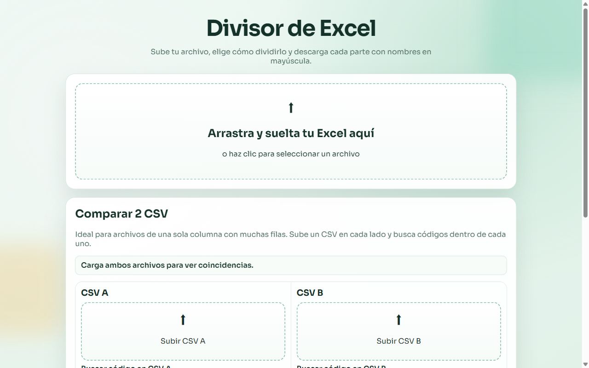
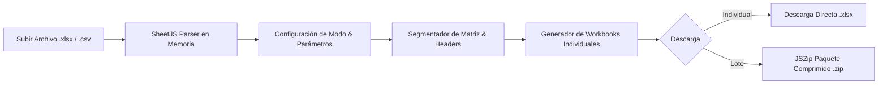

<p align="center">
  
</p>

<p align="center">
  
  
  
  
  
</p>

<p align="center">
  
</p>

## 📊 Visión General

**Divisor de Excel Web** es una aplicación cliente ligera, rápida y privada diseñada para particionar y segmentar hojas de cálculo voluminosas (`.xlsx`, `.xls`, `.csv`) directamente en la memoria del navegador.

Permite a analistas, contadores y desarrolladores dividir bases de datos tabulares masivas respetando siempre los **encabezados de columnas originales**, aplicando nomenclatura estandarizada en mayúsculas (`PARTE_1_...`) y ofreciendo descargas individuales o empaquetadas en un único archivo comprimido `.zip`.

---

## 🖥️ Demostración de la Interfaz

<p align="center">
  
</p>

<p align="center">
  
</p>

## ⚡ Modos de Particionado

El sistema soporta 4 modalidades de división matemática y por contenido:

| Modo de División | Descripción de Funcionamiento |
| :--- | :--- |
| **1. Filas por Parte** | Especifica el límite exacto de registros por archivo (ej. 1,000 filas por parte). El sistema calcula dinámicamente cuántos archivos se crearán. |
| **2. Cantidad de Partes** | Define el número total de fragmentos deseados (ej. dividir en 5 partes iguales). El algoritmo distribuye las filas equitativamente. |
| **3. Dos Partes Personalizadas** | Asigna una cantidad fija a la Parte 1 y deriva automáticamente el remanente a la Parte 2. |
| **4. Por Valor de Columna** | Agrupa y separa registros según el contenido categórico de una columna seleccionada (ej. por País, Sucursal o Estado). |

---

## 🛡️ Privacidad y Seguridad Total

- **Zero Cloud Transfer:** A diferencia de convertidores web en línea que suben hojas confidenciales a servidores remotos, Divisor de Excel opera **100% en la memoria local (RAM) de tu navegador**.
- **Sin Instalaciones:** Funciona en cualquier navegador web moderno sin requerir extensiones ni software adicional.
- **Preservación de Integridad:** Conserva los tipos de datos numéricos, fechas y textos sin corromper tildes o caracteres especiales gracias a su codificación UTF-8 nativa.

---

## 🏛️ Flujo de Operación



---

## 🚀 Inicio Rápido Local

No requiere pasos de compilación ni gestores de dependencias complejos:

### 1. Clonar el repositorio
```bash
git clone https://github.com/santi-osp/Dividir-archivos-de-excel.git
cd Dividir-archivos-de-excel
```

### 2. Abrir en el navegador
Puedes hacer doble clic en `index.html` o servirlo mediante un servidor local:
```powershell
python -m http.server 8080
# Navegar a http://localhost:8080
```

---

## 📁 Estructura del Repositorio

```text
Dividir-archivos-de-excel/
├── docs/
│   ├── images/
│   │   ├── banner.svg           # Hero banner vectorial
│   │   └── divider.svg          # Separador decorativo
│   └── screenshots/
│       └── app-preview.png      # Captura de pantalla de la interfaz
├── index.html                   # Interfaz de usuario accesible y responsiva
├── script.js                    # Motor de particionado (SheetJS + JSZip)
├── styles.css                   # Sistema de diseño moderno con tipografía Sora
└── README.md
```

---

## 👨‍💻 Autor y Licencia

Desarrollado por **Santiago Ospina Arango**  
- **GitHub:** [@santi-osp](https://github.com/santi-osp)  
- **Licencia:** [MIT License](LICENSE)

---

<p align="center">
  <sub>Divisor de Excel Web · Procesamiento de datos privado, rápido y confiable.</sub>
</p>